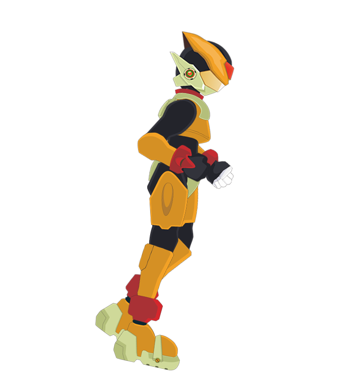
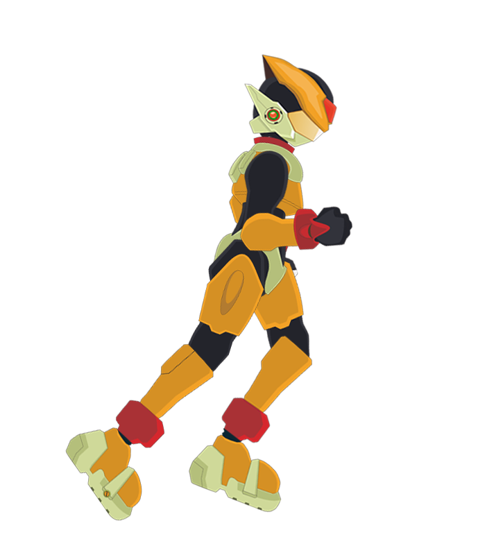
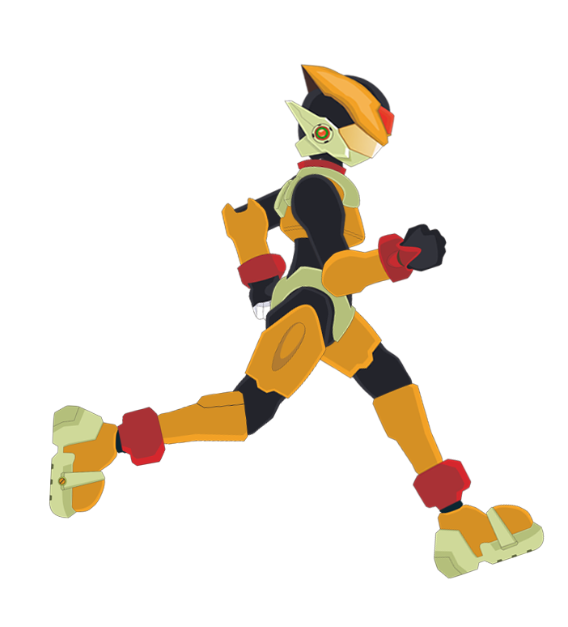
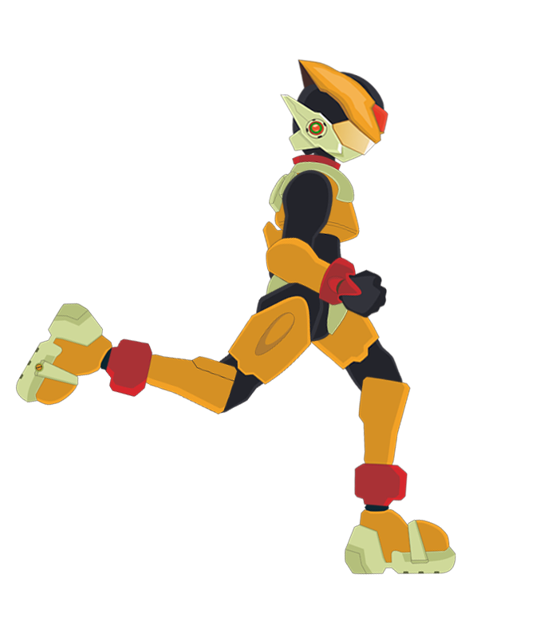
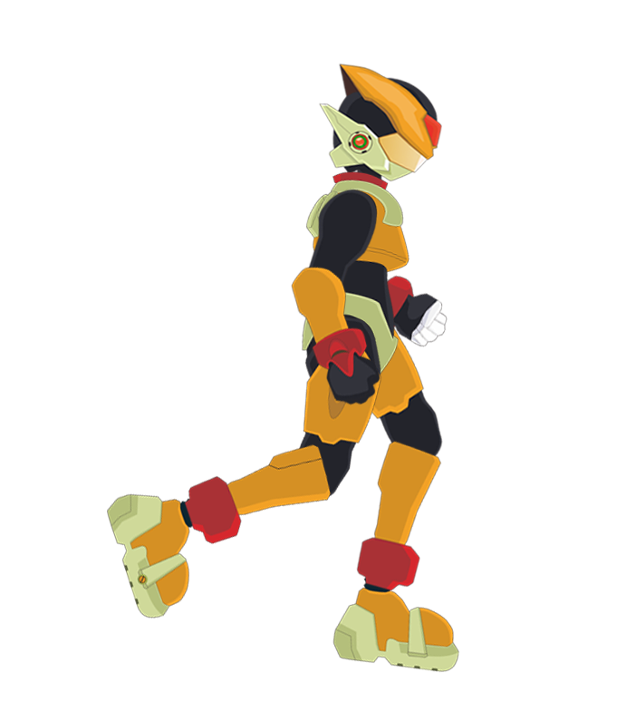
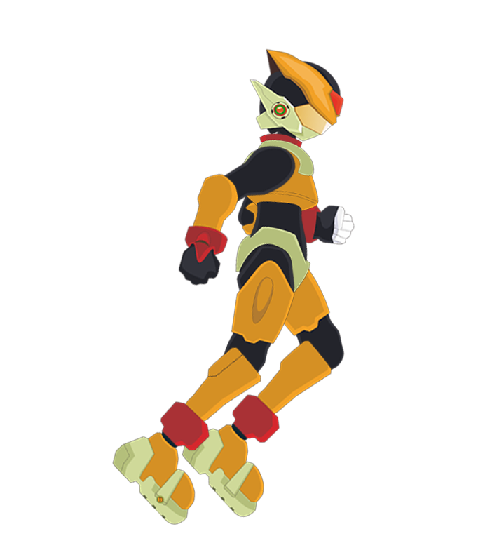
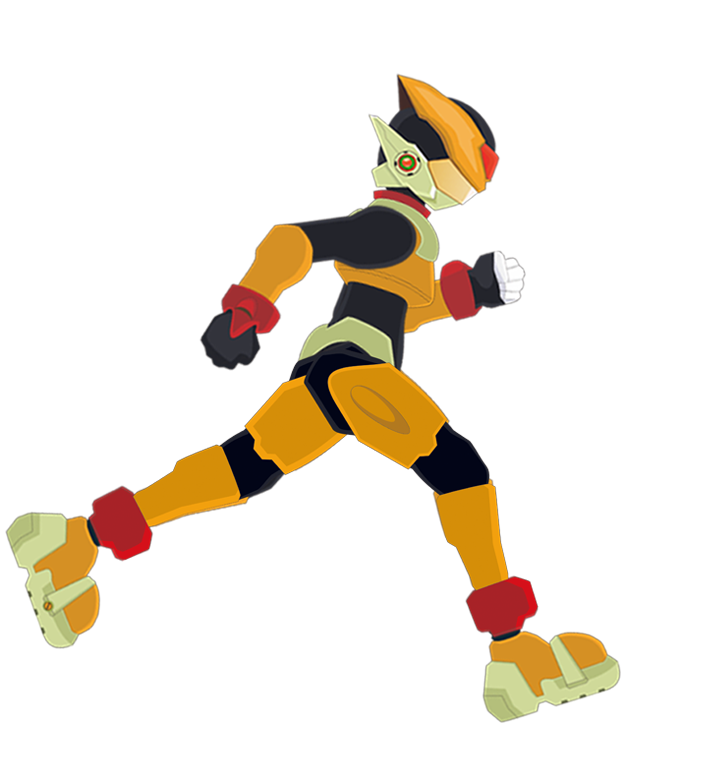
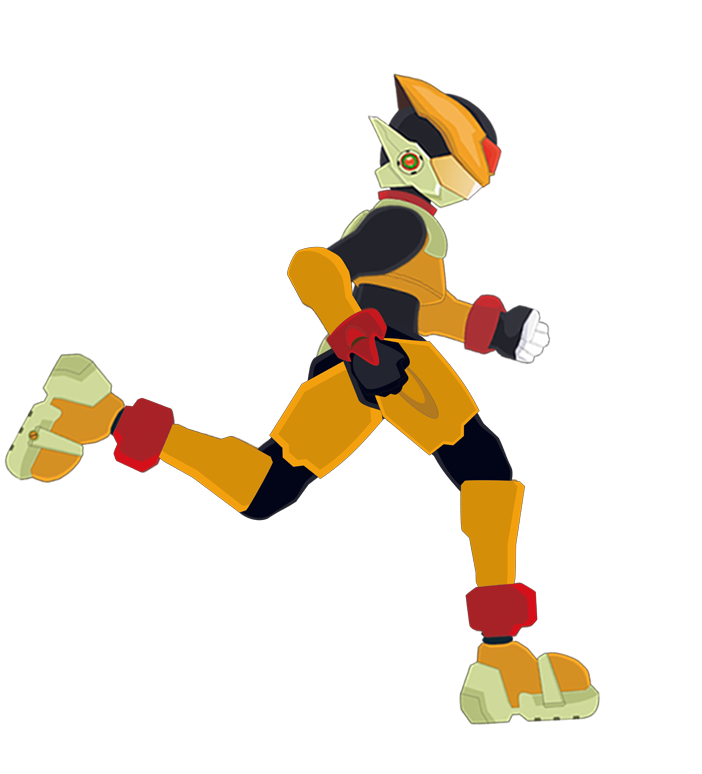
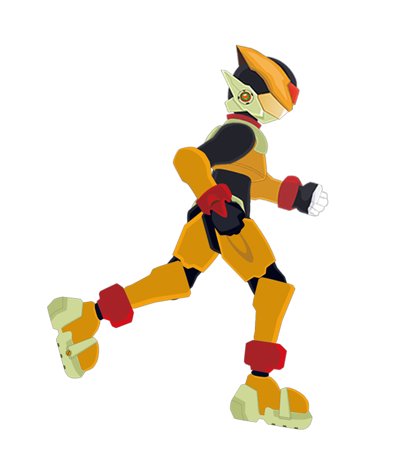

# Jogos 1 — UERJ (2016.1)

Coleção de exercícios e pequenos projetos desenvolvidos em **Lua** durante a disciplina **Jogos 1**, na graduação em Engenharia de Computação da **Universidade do Estado do Rio de Janeiro (UERJ)**.

Os trabalhos foram desenvolvidos como atividades acadêmicas e experimentos práticos, utilizando principalmente o framework **LÖVE (Love2D)** e o ambiente de desenvolvimento **ZeroBrane Studio**. O repositório reúne desde exercícios introdutórios de programação até protótipos com animação, colisão, física, mapas e mecânicas de jogo.

> Este repositório preserva trabalhos acadêmicos de 2016.1. O código tem caráter histórico e educacional, e não representa necessariamente os padrões ou tecnologias que utilizo atualmente.

## Conteúdo do repositório

### Exercícios e experimentos

| Pasta | O que explora |
|---|---|
| `Lista 1` | Exercícios introdutórios de lógica e cálculos, como média de notas, média ponderada, área, distância entre pontos, salário e problemas matemáticos. |
| `Audio` | Reprodução e controle de efeitos sonoros a partir de interações com o mouse. |
| `Bakugou` | Carregamento, rotação e desenho de uma imagem na tela. |
| `Casa` e `Casa 2` | Desenho de cenário, animação de nuvens e movimentação do sol pelo teclado ou mouse. |
| `Cenário 1` | Composição de cenário 2D com elementos gráficos, como nuvens, montanhas, piso e objetos. |
| `Cenário 2` | Construção e movimentação de cenários baseados em mapas de tiles. |
| `Colisao` | Detecção de colisão entre objetos retangulares e restrição de movimento. |
| `Fisica` | Experimentos com mapas, tiles e o sistema de física do LÖVE. |
| `Game Object` | Organização de objetos do jogo em uma estrutura reutilizável, com movimento e colisão. |
| `Hero` | Animação de personagem por sprites, movimentação e reprodução de áudio. |
| `Mapa 2` e `Mapa 3` | Carregamento de mapas, tilesets e experimentos com câmera e visualização de partes do cenário. |
| `Matriz` | Geração e atualização de uma matriz com valores aleatórios, representada graficamente por cores. |
| `Praia` e `Praia Desenho` | Representação de mapas 2D usando matrizes e tiles para areia, grama e água. |
| `Exemplo RPG` | Experimento de RPG 2D com personagem animado e mapa criado no Tiled, usando o AdvTiledLoader. |

### Projeto de jogo: Cyber Venger

A pasta `jogos` contém um protótipo 2D mais completo, chamado **Cyber Venger**. O código mostra a estrutura de um jogo de ação com:

- Personagem controlável, animações de movimento, salto e ataque.
- Inimigos com diferentes comportamentos, movimentação e ataques.
- Três mapas/fases carregados a partir de arquivos de texto.
- Colisões, física, plataformas, espinhos e áreas de ácido.
- Itens coletáveis e sistema de vida.
- Projéteis, efeitos sonoros e música de fase.
- Pausa e transição entre partes dos mapas.

O projeto foi organizado em módulos Lua, como `Hero.lua`, `Inimigo.lua`, `Mapa.lua`, `Fisica.lua`, `Movimentacao.lua`, `Tiro.lua` e `Item.lua`.

### Experimentos gráficos e animações

Há também pequenos projetos de desenho e animação, incluindo:

- `Alemanha`: bandeira alemã e texto animado em movimento.
- `Passeio`: imagem e texto animados como um exercício gráfico.
- `Davirgem Luiz`: experimento visual com imagem e texto em movimento.

## Tecnologias e ferramentas

- **Lua** — linguagem utilizada nos exercícios e jogos.
- **LÖVE (Love2D)** — framework para criação de jogos 2D.
- **ZeroBrane Studio** — ambiente utilizado durante as atividades da disciplina.
- **Tiled / AdvTiledLoader** — utilizados no experimento de RPG para trabalhar com mapas em tiles.

## Capturas de tela

As imagens abaixo estão na pasta `run/` e registram diferentes momentos de execução dos exercícios e protótipos.

<p align="center">
  
  
</p>
<p align="center">
  
  
</p>
<p align="center">
  
  
</p>
<p align="center">
  
  
</p>
<p align="center">
  
</p>

## Como executar

Os projetos que utilizam LÖVE podem ser executados com uma versão compatível do framework instalada.

1. Instale o [LÖVE](https://love2d.org/).
2. Clone este repositório:
   ```bash
   git clone https://github.com/PedroHQCoelho/jogos1.git
   ```
3. Entre na pasta do exercício que deseja executar.
4. Abra a pasta do projeto com o LÖVE ou configure o ZeroBrane Studio para executar o arquivo `main.lua` correspondente.

**Observação:** cada exercício pode ter seus próprios arquivos de imagem, áudio, fontes e mapas. Execute o projeto a partir da pasta dele para que os caminhos relativos dos recursos sejam encontrados.

Os exercícios da pasta `Lista 1` são scripts Lua de terminal e podem ser executados com um interpretador Lua compatível.

## Contexto acadêmico

Estes projetos foram desenvolvidos durante a disciplina **Jogos 1**, no período **2016.1**, como parte da graduação em Engenharia de Computação na UERJ. Foram oportunidades para praticar fundamentos de programação e explorar conceitos de desenvolvimento de jogos, como animação, interação, colisão, física, mapas e organização de código.

---

**Autor:** Pedro Coelho  
**Curso:** Engenharia de Computação — UERJ  
**Disciplina:** Jogos 1 — 2016.1  
**Linguagem:** Lua  
**Ambiente de desenvolvimento:** ZeroBrane Studio

[GitHub — PedroHQCoelho](https://github.com/PedroHQCoelho)
